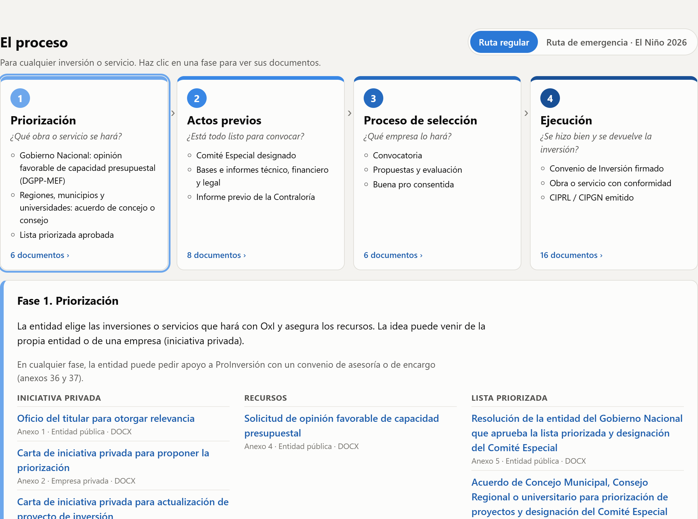

# Obras por Impuestos en 4 fases (actualizado a 2026)

[Ver el tablero](https://ecamachoro-bit.github.io/oxi-4-fases/) · Tablero interactivo que simplifica el proceso de **Obras por Impuestos (OxI)** en las 4 fases que usa el MEF: priorización, actos previos, proceso de selección y ejecución. Tiene dos rutas:

| Ruta | Norma | Modelos | Elegir a la empresa* |
|---|---|---|---|
| Regular | RD N° 005-2024-EF/68.01 (*El Peruano*, 21/12/2024) | 38 | hasta 42 días hábiles |
| Emergencia El Niño 2026-2027 | D.U. N° 010-2026 y RD N° 004-2026-EF/68.01 (*El Peruano*, 06/09/2026) | 23 | hasta 14 días hábiles |

\* Desde la convocatoria o la invitación hasta que la empresa presenta los requisitos del convenio.

También resume los cambios de 2026: la Ley N° 32460 (02/10/2025) y el nuevo Reglamento, D.S. N° 038-2026-EF (vigente desde el 14/03/2026), que derogó el D.S. N° 210-2022-EF.



## Descargas
- `web/descargas/oxi_ruta_regular_RD005-2024.zip`: la RD y los 38 anexos (54 MB).
- `web/descargas/oxi_ruta_emergencia_RD004-2026.zip`: la RD y los 23 anexos (1,3 MB).

**Ojo:** los 38 modelos regulares se aprobaron con el Reglamento anterior. El MEF los sigue publicando y las entidades pueden adecuarlos, pero conviene contrastarlos con el Reglamento 2026.

## Cómo se construyó (Python)

```bash
pip install -r requirements.txt
python scripts/descargar_documentos.py   # ruta regular: copia oficial del MVCS en Google Drive (la web del MEF bloquea bots)
curl -sL -o datos/gobpe_rd_004-2026.html https://www.gob.pe/institucion/mef/normas-legales/8563340-004-2026-ef-68-01
python scripts/descargar_2026.py         # ruta de emergencia: gob.pe
python scripts/extraer_textos.py         # texto y métricas: python-docx, pypdf, openpyxl
python scripts/preparar_web.py           # web/data/proceso.js y los ZIP
python scripts/capturar.py               # capturas (selenium)
python video/armar_video.py              # video sin voz con subtítulos (Pillow + FFmpeg)
```

Fuentes del proceso: presentación DGPPIP-MEF *Obras por Impuestos: información general* (4 fases), los propios modelos (plazos), ProInversión, Cuatrecasas y AFIN (Reglamento 2026). El tablero simplifica el proceso: no reemplaza la Ley, el Reglamento ni los modelos.

## Video
`video/video_oxi_documentos.mp4`: 75 s, 1080 × 1350, **sin voz**, con subtítulos incrustados. Incluye además `video/subtitulos.srt` y `video/portada.png`.

---
Eliana Camacho Cárdenas · Python intermedio, QLAB PUCP · noviembre 2026
